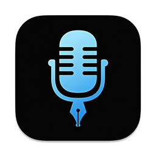

  
  <h1>Voice</h1>
  
Voice to text app for macOS that transcribes what you say almost instantly

  
  

---

Voice is a native macOS dictation app. It transcribes speech with local or cloud models, can clean up the text with an AI model, and pastes the result into whatever app you're using.

Voice is a modified version of [VoiceInk](https://github.com/Beingpax/VoiceInk) by Prakash Joshi Pax, used under the GNU General Public License v3.0. It is not affiliated with or supported by the VoiceInk project.

## Features

- 🎙️ **Transcription**: Local Whisper, Parakeet and GGUF models, or cloud providers
- 🩺 **Clinic Notes**: Dictate a note in several parts and have it rewritten once, in your own note format
- ⚡ **Modes**: Settings that switch automatically based on the app or website you're in
- 🧠 **Context aware**: Optionally uses selected text, the clipboard or the active window to improve accuracy
- 🎯 **Global shortcuts**: Keyboard or mouse shortcuts, with toggle and push-to-talk
- 📝 **Personal dictionary**: Custom words, industry terms and text replacements
- 🤖 **AI assistant**: A voice assistant mode for quick questions

## Build from Source

Follow the instructions in [BUILDING.md](BUILDING.md). `make local` builds `Voice.app` into `~/Downloads`.

The first time Voice launches, it copies your History, dictionary, modes, models and settings from VoiceInk if VoiceInk is installed. VoiceInk itself isn't changed. API keys, and the Microphone, Accessibility and Screen Recording permissions, have to be set up again.

## Requirements

- macOS 26 or later

## Documentation

- [Building from Source](BUILDING.md) - Detailed instructions for building the project
- [Contributing Guidelines](CONTRIBUTING.md) - How to contribute to Voice
- [Code of Conduct](CODE_OF_CONDUCT.md) - Our community standards

## License

This project is licensed under the GNU General Public License v3.0 - see the [LICENSE](LICENSE) file for details.

## Acknowledgments

- [VoiceInk](https://github.com/Beingpax/VoiceInk) by Prakash Joshi Pax - The app Voice is based on

### Core Technology
- [whisper.cpp](https://github.com/ggerganov/whisper.cpp) - High-performance inference of OpenAI's Whisper model
- [FluidAudio](https://github.com/FluidInference/FluidAudio) - Used for Parakeet model implementation
- [TranscribeCpp for Swift](https://github.com/Beingpax/Transcribe-cpp-swift) - SwiftPM distribution of [transcribe.cpp](https://github.com/handy-computer/transcribe.cpp), used for local GGUF transcription models
- [SenseVoice Small](https://huggingface.co/FunAudioLLM/SenseVoiceSmall) by FunAudioLLM / Alibaba - Multilingual model available under the [FunASR Model Open Source License Agreement](https://github.com/modelscope/FunASR/blob/main/MODEL_LICENSE)

### Essential Dependencies
- [Sparkle](https://github.com/sparkle-project/Sparkle) - App updates (inactive until an update feed is configured)
- [KeyboardShortcuts](https://github.com/sindresorhus/KeyboardShortcuts) - User-customizable keyboard shortcuts
- [LaunchAtLogin](https://github.com/sindresorhus/LaunchAtLogin) - Launch at login functionality
- [MediaRemoteAdapter](https://github.com/ejbills/mediaremote-adapter) - Media playback control during recording
- [Zip](https://github.com/marmelroy/Zip) - File compression and decompression utilities
- [SelectedTextKit](https://github.com/tisfeng/SelectedTextKit) - A modern macOS library for getting selected text
- [Swift Atomics](https://github.com/apple/swift-atomics) - Low-level atomic operations for thread-safe concurrent programming
